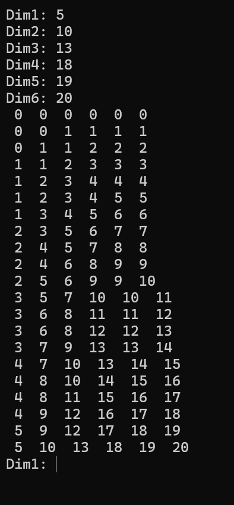

# Algoritmo de Bresenham para n-dimensiones  
## (Cualquier número de dimensiones)

Este es un ejemplo de algoritmo de Bresenham para n-dimensiones (cualquier número de dimensiones). En el ejemplo que he subido está por defecto para 6 pero se puede utilizar para cualquier otro número de dimensiones. Si abres el programa te indico a modo de comentario dónde tocar para cambiar el número de dimensión y los formateos para las entradas y salidas de datos.

Al ejecutar el programa te pedirá un número entero (no importa si es positivo o negativo) para cada dimensión. Introduces el valor entero y luego pulsas *enter* para cada dimensión.

También te dejo el .exe por si quieres probarlo ahora mismo. El programa está escrito y compilado en el lenguaje de programación FreeBasic.
